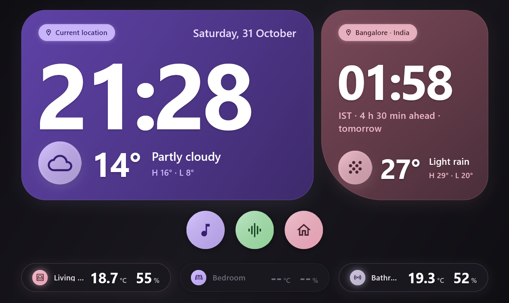

# Smart Clock

Turn your old tablets into a beautiful, functional smart clock display.



## Overview

**Smart Clock** is a Flutter-based application designed to transform old tablets into dedicated smart clock displays. It features animated time displays, timezone support, weather integration, and sensor data visualization. The app runs on both **Android** and **Windows** platforms.

The design features a clean dark theme with purple/indigo accent colors, displaying both local time and Bangalore (IST) time side-by-side, along with weather and sensor information.

## Features

- **Animated Time Display**: Smooth scale and opacity animations when the time updates every second
- **Dual Timezone Support**: Shows both local time and Bangalore/IST time (with UTC+5:30 offset calculation)
- **Format Toggle**: Long-press the local card to switch between 24-hour and 12-hour format
- **Weather Integration**: Displays weather information row at the bottom of each card
- **Sensor Data**: Shows Bluetooth sensor data on the right side of the dashboard
- **Responsive Design**: Layout adapts to 1280x800 default design, scaled to fit various screen sizes
- **Platform Support**: Android and Windows builds available

## Architecture

The app uses the **BLoC (Business Logic Component)** pattern with **hydrated_bloc** for state persistence:

- **ClockBloc**: Manages time state, ticks every second, handles format toggling
- **WeatherBloc**: Fetches and manages weather data
- **SensorBloc**: Manages Bluetooth sensor data
- **DockBloc**: Handles the dock/bottom bar state

State management uses `Equatable` for easy state comparison and change detection. The app uses `HydratedStorage` to persist the hour24 format preference.

## Project Structure

```
smart_clock/
├── lib/
│   ├── main.dart              # App entry point and MaterialApp configuration
│   ├── features/
│   │   ├── clock/             # Core clock functionality
│   │   │   ├── clock_bloc.dart        # Time BLoC
│   │   │   ├── clock_event.dart       # Clock events (tick, format toggle)
│   │   │   ├── clock_state.dart       # Clock state (now, hour24)
│   │   │   ├── clock_store.dart       # Source of ticks and wall-clock time
│   │   │   └── view/                  # UI components
│   │   │       ├── clock_cards.dart   # Animated time cards (Local + India)
│   │   │       └── ...                # Other UI widgets
│   │   ├── dock/                # Bottom dock bar
│   │   ├── sensor/              # Bluetooth sensor strip
│   │   └── weather/             # Weather display
│   └── ...                      # Generated and config files
├── android/                     # Android-specific configuration
├── windows/                     # Windows-specific configuration
└── build/                       # Build outputs (generated)
```

## Key UI Components

### Clock Cards (`clock_cards.dart`)

The app features two clock cards:

| Card | Description |
|------|-------------|
| **LocalCard** | Shows current location, date, and animated local time (left side) |
| **IndiaCard** | Shows Bangalore · India time with IST offset, animated time (right side) |

**Animations** (recently enhanced):

- Scale animation: 0.97 → 1.0 with `Curves.easeOutCubic`
- Opacity fade-in: 0 → 1 over 350ms
- Color fade-in: Text fades from transparent to white

Both cards long-pressable to toggle between 24h and 12h format.

### Layout

The default layout is designed for **1280x800** screens, using a `FittedBox` to scale proportionally:

- Left column: Local card (flex 175)
- Spacer (flex 20)
- Right column: India card (flex 100)
- Bottom: Dock bar, Sensor strip

## Available Scripts

### Build Windows (Release)

```bash
flutter build windows --release
```

Output: `build\windows\x64\runner\Release\smart_clock.exe`

### Build Android (Release)

```bash
flutter build android --release
```

### Run App

```bash
flutter run
```

## Design References

The visual design inspiration comes from a Claude.ai artifact (e59fe94d-aac8-467b-9674-5b337327b958) featuring:

- Dark gradient theme (0F0E13 → 1A181F → 0F0E13)
- Purple accent colors (5E42A6 → 4F378B → 3D2A6B for local, 7A4A5A → 633B48 → 4A2E3A for India)
- Cyan/teal accent (D0BCFF)
- Prominent large time display (240px for local, 128px for India)

## Development

### Prerequisites

- Flutter SDK (3.13.7+)
- Dart SDK
- Windows/machine with Flutter installed

### Adding Features

1. Create new BLoC following the pattern: `event.dart`, `state.dart`, `bloc.dart`
2. Add UI widgets in the appropriate `view/` directory
3. Register the new bloc in `main.dart` `MultiBlocProvider`
4. Update `WallDisplay` layout if adding new UI elements

### Animation Enhancements

Recent improvements to `_AnimatedTime` in `clock_cards.dart`:

- **Duration**: Increased from 300ms to 350ms
- **Scale**: Changed from 0.95→1.0 to 0.97→1.0 (subtler)
- **Color**: Added fade-in from transparent → white for depth

The animations trigger on every second tick and on format toggle.

## License

MIT License - see LICENSE file for details.
